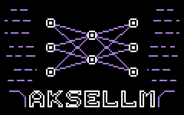
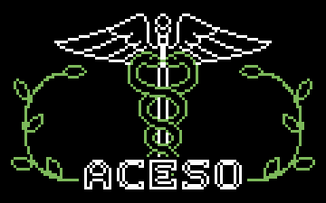
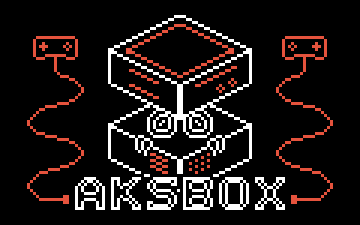
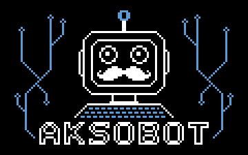

<picture>
  <source media="(prefers-color-scheme: dark)" srcset="assets/name-dark.png">
  
</picture>

**software developer** &nbsp;&nbsp;&nbsp; also going by **axilian**

Most of what I build runs on hardware I own; local LLM tooling, 
microcontroller firmware, and the web apps that sit in front of them.

[**akselihyv.com**](https://akselihyv.com) &nbsp;&nbsp;&nbsp; [**linkedin**](https://www.linkedin.com/in/akseli-hyv%C3%B6nen/) &nbsp;&nbsp;&nbsp; [**akselihyv@gmail.com**](mailto:akselihyv@gmail.com)

---

## Projects

<table>
<tr>
<td width="50%" valign="top">

#### [AkseLLM](https://github.com/AkseliHyv/aksellm)

Self-hosted web app for managing and chatting with local LLM configurations that run on [Ollama](https://ollama.com). Each configuration keeps its own sampling parameters and system prompt, with a persistent message history.

`React` `TypeScript` `ASP.NET Core` `C#` `Supabase` `Docker`

**Complete**

</td>
<td width="50%" valign="top">

#### [Aceso](https://github.com/AkseliHyv/aceso)

MicroPython firmware for a heart rate variability monitor that measures through photoplethysmography. Runs on a Pico W with a pulse sensor and an OLED display, with an on-device UI for taking a reading and reviewing results.

`MicroPython` `Raspberry Pi Pico W` `MQTT`

**Complete**

</td>
</tr>
<tr>
<td width="50%" valign="top">

#### [AksBox](https://github.com/AkseliHyv/aksbox)

A game console built on an ESP32-S3. A launcher lists games from plug-in cartridges and an internal microSD library, flashes the chosen one into a spare app partition and boots it. Launcher and games share one engine written in C.

`C` `ESP32-S3` `ESP-IDF` `FreeRTOS`

**In progress**

</td>
<td width="50%" valign="top">

#### aksobot

A voice robot that listens through a custom activity detector, transcribes with Faster Whisper, thinks with a local model on Ollama, and talks back. Built to live inside a physical robot on a Raspberry Pi.

`Python` `Raspberry Pi` `Faster Whisper` `Ollama` `Edge TTS`

**In progress**
</table>

---

## Tools

| Area | Stack |
| --- | --- |
| **Languages** | `C#` &nbsp;`TypeScript` &nbsp;`JavaScript` &nbsp;`Python` &nbsp;`C` &nbsp;`PHP` |
| **Frontend** | `React` &nbsp;`Next.js` &nbsp;`Blazor` &nbsp;`Tailwind` &nbsp;`HTML` &nbsp;`CSS` &nbsp;`WPF/WinForms` |
| **Backend** | `ASP.NET Core` &nbsp;`Node.js` &nbsp;`Express` &nbsp;`REST APIs` |
| **Data** | `PostgreSQL` &nbsp;`MySQL` &nbsp;`MongoDB` &nbsp;`Supabase` |
| **Infrastructure** | `Docker` &nbsp;`Kubernetes` &nbsp;`Linux` &nbsp;`Git` |
| **Embedded** | `ESP32` &nbsp;`Raspberry Pi` &nbsp;`Pico W` &nbsp;`MicroPython` &nbsp;`MQTT` |
| **Other** | `Ollama` &nbsp;`Unity` |
